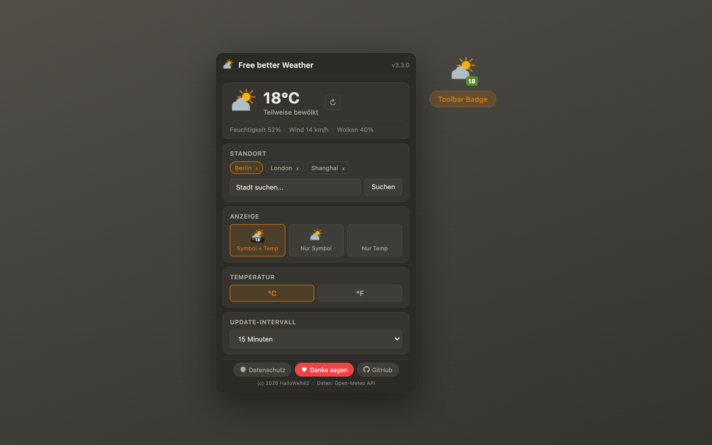

# Free better Weather

Chrome Extension -- Wetterdaten direkt im Browser-Toolbar.

## Features

- Aktuelle Wetterdaten via Open-Meteo API (weltweit)
- Temperatur als Badge im Toolbar-Icon
- Canvas-basierte Wetter-Symbole (15 Wetterbedingungen)
- Stadtsuche via Nominatim (OpenStreetMap) -- weltweit
- Konfigurierbares Update-Intervall (5-60 Minuten)
- Intelligentes Caching -- minimale API-Belastung
- Dark/Light Mode (automatisch)
- 20 Sprachen
- Keine Registrierung, kein API-Key erforderlich

## Installation

1. `chrome://extensions` öffnen
2. "Entwicklermodus" aktivieren
3. "Entpackte Erweiterung laden"
4. Dieses Verzeichnis auswählen

## Datenquellen

- **Wetter:** [Open-Meteo API](https://open-meteo.com/) -- Kostenlose weltweite Wetterdaten
- **Geocoding:** [Nominatim](https://nominatim.openstreetmap.org/) -- OpenStreetMap

## Datenschutz

Alle Daten werden lokal gespeichert. Kein Tracking, keine Analytics.
Details: [PRIVACY.md](PRIVACY.md)

## Lizenz

CC BY-NC-ND 4.0 -- (c) 2025-2026 HalloWelt42

Siehe [LICENSE](LICENSE) für Details.
